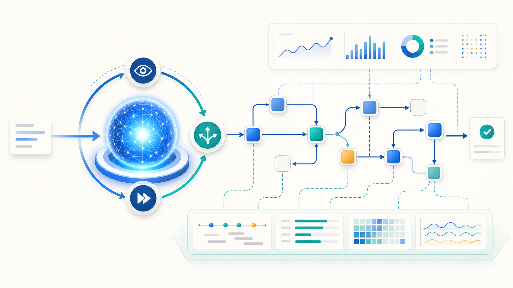
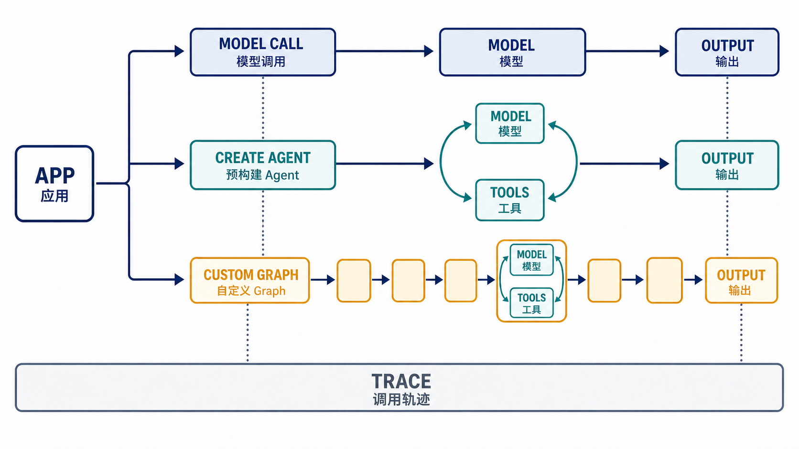

# 第 01 篇｜LangChain.js、LangGraph 与 Agent 到底是什么关系



*图 1-1：模型能力、Agent 循环、Graph 运行时与质量观测共同组成一个可控的 Agent 系统。*

> **本文导读：** 当一次模型调用逐渐加入工具、分支、循环、人工审批和中断恢复时，团队很容易混淆 LangChain.js、LangGraph 与 Agent 的职责。本文将从一个文章研究助手出发，区分 Model（模型）、Workflow（工作流）、Agent（智能体）与 Graph（执行图），梳理三套技术各自解决的问题。读完后，你应该能根据控制权、状态和恢复需求选择最小可用方案。

这是《从调用模型到构建 Agent》系列的第一篇。

我们暂时不写复杂代码，先把整个技术栈的边界画清楚。

## 上一阶段的局限：一次模型调用开始失控

假设我们要做一个“AI 技术文章研究助手”。第一版只有一个需求：用户输入主题，系统返回文章大纲。

这时，一次大语言模型（Large Language Model，LLM）调用就够了：

```text
用户输入主题 → 模型生成大纲 → 页面展示结果
```

这个方案简单、直接，也容易调试。问题出现在需求继续增长之后：

- 生成大纲前，需要先确认目标读者；
- 写作前，需要搜索最新的官方文档；
- 不同章节应该并行研究；
- 资料不足时，需要继续检索；
- 发布前，必须检查引用并等待作者确认；
- 服务重启后，不能丢失已经完成的工作。

此时，原来的“一次输入、一次输出”变成了多阶段任务。状态开始散落在函数参数、数据库和页面中，控制流则隐藏在 `if`、循环和回调里。

团队通常会提出三个方案：使用 LangChain.js、改用 LangGraph，或者直接做一个 Agent。

问题在于，这三个概念并不处在同一个层面。LangChain.js 和 LangGraph 是开发工具，Agent 则是一种运行方式。把它们放在一起二选一，无法得到正确答案。

## 当前阶段是什么：先分清能力、控制流和运行时

先给出本文的核心判断：

> **模型提供概率性能力，LangChain.js 提供模型应用与预构建 Agent 所需的通用抽象，LangGraph 管理长时间、有状态的执行过程，LangSmith 负责观察和评价运行质量。Agent 则表示由模型参与下一步行动选择的运行模式。**

这句话包含四个不同层次。

| 层次 | 核心问题 | 典型内容 |
| --- | --- | --- |
| 模型能力 | 能否理解、生成或判断 | 摘要、分类、生成、工具选择 |
| 应用抽象 | 怎样连接模型与程序 | 消息、工具、结构化输出、预构建 Agent |
| 执行控制 | 状态怎样变化，流程怎样继续 | 分支、循环、并行、暂停、恢复 |
| 质量反馈 | 系统在哪里出错，改动后是否变好 | 调用轨迹、评估、监控 |

### Model、Chain、Workflow、Agent 和 Graph

Model（模型）是一次概率性计算。它根据当前输入生成文字或结构化决策，但不会自动保存业务状态，也不会真正执行外部函数。

Chain（调用链）是按固定顺序执行的一组步骤。例如“提取主题 → 生成大纲 → 生成正文”。步骤可以调用模型，也可以是普通 TypeScript 函数。

Workflow（工作流）是在调用链基础上加入预先定义的分支、循环或并行。模型可以参与某个步骤，但整体路径主要由代码控制。

Agent（智能体）是一种动态运行模式。模型可以根据当前任务选择下一步动作，例如决定搜索哪份资料、是否继续搜索，以及何时返回最终答案。

Graph（执行图）使用 Node（节点）表示计算、Edge（边）表示控制流、State（状态）保存运行中的共享数据。Graph 可以是完全确定的工作流，也可以把 Agent 放进其中一个节点。

因此，Graph 不等于 Agent。前者负责表达和运行状态变化，后者表示模型获得了部分流程选择权。

## 完整流程：同一个应用的三条执行路径

同一个应用可以根据任务复杂度选择三条路径。



*图 1-2：应用可以直接调用模型、使用预构建 Agent，或进入自定义 Graph；三条路径都需要被调用轨迹观察。*

图中的英文标签分别表示：

- `APP`：Application（应用）；
- `MODEL CALL`：模型调用；
- `CREATE AGENT`：创建预构建 Agent；
- `CUSTOM GRAPH`：自定义执行图；
- `MODEL`：模型；
- `TOOLS`：工具；
- `TRACE`：调用轨迹；
- `OUTPUT`：最终输出。

第一条路径只有一个模型调用，适合摘要、抽取和改写。第二条路径让模型在工具之间动态选择，适合开放式查询。第三条路径把固定业务阶段和动态 Agent 组合起来，适合存在并行、审批或恢复要求的任务。

这三条路径不是从低级到高级的升级路线。选择标准是控制流复杂度，而不是技术数量，也不是项目规模。

## 分步骤讲解

### 第一步：先判断是否真的需要模型

如果业务规则可以明确写成代码，就不应该让模型猜。

例如，下面这些任务使用普通 TypeScript 更合适：

- 根据发布日期排序文章；
- 判断章节数量是否超过上限；
- 检查引用编号是否连续；
- 校验链接是否来自允许的域名。

模型适合处理语义模糊、规则难以穷举的任务，例如判断一份资料是否与主题相关，或者为不同读者生成不同的大纲。

#### 直接模型调用

当任务只有一次独立的语义转换，并且不需要工具和长期状态时，直接调用模型最简单。

用在文章研究助手中，就是根据主题生成一份初步大纲。它解决“从自然语言主题得到候选内容”的问题，但不能解决资料检索、进度恢复和人工审批。

### 第二步：固定路径交给 Workflow

如果多个步骤的顺序可以提前确定，就让代码保留控制权。

例如，文章必须依次经过：

```text
检查输入 → 生成大纲 → 校验章节数量 → 返回结果
```

这里即使有两个步骤调用模型，整体仍然是 Workflow。模型负责完成某个语义任务，代码负责保证每个必经阶段都会执行。

Workflow 解决的是“流程必须按业务规则运行”。它的局限是无法提前列出所有路径时，条件分支会越来越多。

### 第三步：动态工具选择交给 Agent

当系统无法提前确定要调用几次工具、以什么顺序调用时，可以把这部分选择权交给 Agent。

#### Tool Calling（工具调用）

Tool（工具）是应用提供给模型选择、但仍由运行时实际执行的外部能力。Tool Calling 是模型生成工具名称和参数，再由应用校验并执行的机制。

模型不会亲自搜索网页。它只会产生类似“调用文档搜索工具，查询 LangGraph 持久化机制”的请求。应用收到请求后，才会检查参数、执行搜索，并把结果重新加入上下文。

#### Agent Loop（Agent 循环）

Agent 的动态能力来自一个“观察—行动—再观察”的循环。下面使用 TypeScript 风格伪代码表示主流程：

```ts
async function runAgent(question: string, tools: Tool[]) {
  const messages = [question]; // 保存模型当前能够看到的任务和观察结果

  for (let step = 0; step < MAX_STEPS; step++) { // 限制循环次数，避免无限调用
    const decision = await model.decide(messages, tools); // 让模型选择回答或请求工具

    if (decision.type === "final") { // 模型已经得到答案时结束本轮任务
      return decision.answer; // 将最终结果返回给应用
    }

    const call = validateToolCall(decision); // 在执行前校验工具名称、参数和权限
    const observation = await executeTool(call); // 由应用真正访问外部系统
    messages.push(decision, observation); // 把工具结果写回上下文，供模型继续判断
  }

  throw new Error("Agent 超过最大步骤数"); // 超出预算时以受控错误结束
}
```

这段伪代码说明，Agent 不是一个更聪明的模型，而是模型与运行时共同组成的控制循环。模型负责提出动作，应用负责验证、执行和停止。

#### LangChain.js 与 createAgent

LangChain.js 是面向模型应用的 JavaScript/TypeScript 框架。它提供 Messages（消息协议）、Tools（工具）和 Structured Output（结构化输出）等通用抽象，也提供 `createAgent` 这样的预构建 Agent。

当任务主要是“让模型在若干工具之间选择，直到得到答案”时，`createAgent` 提供了合适的默认循环。开发者不必从头处理模型响应、工具调用和消息回传。

Middleware（中间件）是包裹模型或工具调用的处理层。它可以加入重试、上下文裁剪、日志或人工审批，但属于可选优化，不应该为了使用而使用。

### 第四步：复杂状态和恢复交给 LangGraph

当整体流程出现明确阶段、并行任务、长时间等待或恢复要求时，只使用 Agent Loop 会遇到两个问题：业务规则藏在提示词里，运行状态藏在消息历史里。

#### LangGraph 的作用

LangGraph 是面向长时间、有状态任务的低层编排框架与运行时。这里的“低层”不是能力更弱，而是开发者需要显式设计 State、Node 和 Edge，从而获得更细的控制。

它适合表达这样的文章流程：

```text
确认写作目标
→ 生成研究计划
→ 并行研究多个章节
→ 汇总资料
→ 检查引用
→ 等待人工审核
→ 发布文章
```

固定业务阶段由 Graph 保证，开放式资料搜索则可以交给某个 Agent 节点。确定性代码和模型决策因此能够出现在同一个流程中。

#### 为什么 createAgent 和 LangGraph 不是二选一

根据 LangChain.js v1 的官方定位，`createAgent` 本身建立在 LangGraph 之上。使用它，等于复用一个已经设计好的 Agent Graph。

反过来，自定义 LangGraph 的节点也可以调用 LangChain.js 的模型、工具或完整 Agent。

两种组合方式分别适合：

| 组合方式 | 使用场景 | 解决的问题 |
| --- | --- | --- |
| LangChain.js `createAgent` | 主要变化来自工具选择 | 快速获得标准 Agent Loop |
| 自定义 LangGraph + LangChain.js 组件 | 固定阶段与动态决策并存 | 显式管理状态和控制流 |
| 自定义 Graph 中嵌入 Agent | 只有部分任务路径无法预先确定 | 限制 Agent 的职责范围 |

#### 长时间运行能力

Durable Execution（持久化执行）表示运行过程可以保存进度，并在进程中断后恢复。Checkpoint（检查点）是保存下来的状态快照。

Streaming（流式输出）让前端持续接收内容或状态变化。Human-in-the-loop（人在回路）则允许流程暂停，等待用户批准、修改或拒绝后继续。

这些能力解决的是执行可靠性，不保证模型生成的内容一定正确。

### 第五步：用 LangSmith 建立反馈回路

用户看到一个错误答案时，问题可能来自错误上下文、错误工具、错误参数，也可能来自某个路由节点。

LangSmith 是用于调试、评估和监控模型应用的工程平台。Trace（调用轨迹）把一次运行中的模型调用、工具调用、状态变化和耗时连接起来，帮助开发者定位错误最早出现的位置。

LangSmith 属于工程配套，不参与 Agent 的核心决策。没有它，应用仍然可以运行；但缺少轨迹和评估后，团队很难证明一次修改究竟让系统变好还是变差。

## 引入的技术与常见方案

回到文章研究助手，可以按下面的方式选择，而不是一次引入全部技术：

| 技术或方案 | 分类 | 用在哪里 | 为什么使用 | 解决什么问题 |
| --- | --- | --- | --- | --- |
| 直接模型调用 | 核心能力 | 单次生成或分类 | 路径简单 | 完成语义任务 |
| LangChain.js 通用抽象 | 核心能力 | 模型、消息、工具边界 | 统一应用与模型的交互 | 减少接入层差异 |
| `createAgent` | 按需使用 | 动态工具选择 | 复用标准循环 | 避免手写 Agent Loop |
| Middleware | 可选优化 | 模型与工具调用周围 | 集中处理横切逻辑 | 重试、裁剪、审批 |
| 自定义 LangGraph | 按需使用 | 复杂业务流程 | 显式控制状态和路径 | 分支、并行、暂停、恢复 |
| LangSmith | 工程配套 | 开发、测试和运行阶段 | 观察执行过程 | 调试、评估和监控 |

一个实用原则是：

> **从能够满足当前需求的最小控制结构开始。只有当现有结构无法清楚表达状态和流程时，才增加下一层抽象。**

## 本阶段解决的问题

第一篇没有让文章研究助手获得新的业务功能，但完成了更重要的架构决策：

1. 生成、分类等语义能力交给模型；
2. 消息、工具和结构化输出使用 LangChain.js 抽象；
3. 标准工具选择优先使用 `createAgent`；
4. 研究、写作、审核等整体阶段由 LangGraph 约束；
5. 只有开放式研究任务获得动态行动权；
6. 运行过程通过 LangSmith 观察和评估。

这个边界避免了两个极端：把全部复杂度藏进一个提示词，或者为一次简单生成提前设计大型 Graph。

## 当前局限与下一阶段

现在，我们已经知道不同组件应该放在哪里，却仍然没有回答一个基础问题：模型调用为什么不能像普通函数一样被信任？

一次请求返回成功，只能说明网络和服务正常。模型输出还可能格式错误、遗漏条件、引用旧知识，或者给出听起来合理但无法验证的内容。

下一篇将从文章研究助手的第一次失败开始，区分传输成功、格式正确、事实正确和任务完成，并建立管理模型不确定性的第一层边界。

> 下一篇：**LLM 应用为什么不是普通的函数调用**

---

更新记录：

- 2026-08-11：完成结构重构，并加入 AI 生成的 PNG 首图与流程图。
- 2026-08-11：为架构流程图补充中英双语标注。
