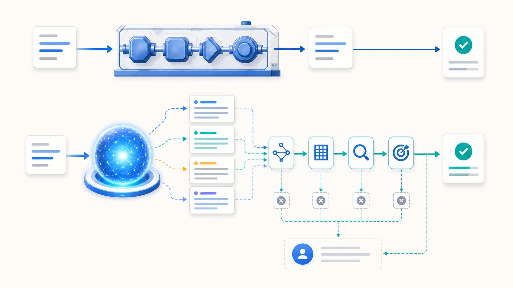
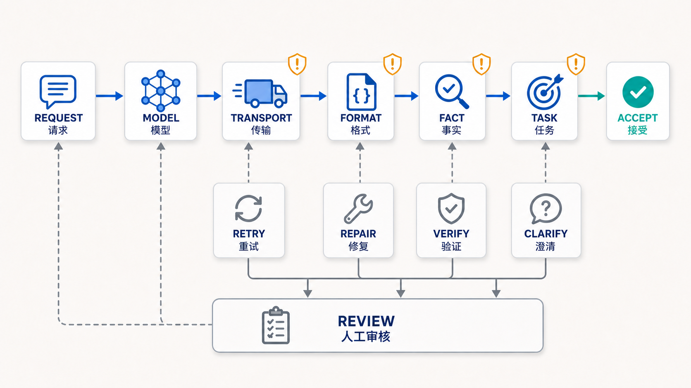

# 第 02 篇｜LLM 应用为什么不是普通的函数调用



*图 2-1：确定性程序沿着单一路径得到结果，模型输出则需要经过多层检查才能进入业务系统。*

> **本文导读：** 大语言模型（Large Language Model，LLM）接口返回成功，并不代表输出可以直接使用。本文将通过文章研究助手的一次失败，解释确定性函数与概率模型的区别，拆分传输、格式、事实和任务完成四层检查，并说明何时重试、修复、验证、澄清或转交人工。

上一篇介绍了 LangChain.js、LangGraph 与 Agent 的关系。

我们把模型能力、应用抽象、执行控制和质量反馈放到了不同层次，也确定了文章研究助手的整体边界。

但这个架构仍然隐藏着一个假设：只要模型接口调用成功，后续流程就能继续。第二篇要处理的，正是这个假设带来的问题。

## 上一阶段的局限：接口成功不等于任务成功

文章研究助手的第一项业务能力，是根据主题生成文章大纲。

假设用户提出下面的要求：

```text
主题：LangGraph 的状态管理
读者：熟悉 TypeScript 的前端开发者
要求：生成 6 个章节，包含 State、Node、Edge 和 Reducer
```

应用发送请求，模型服务正常返回，超文本传输协议（Hypertext Transfer Protocol，HTTP）状态码也是 `200`。

从接口层看，这次调用成功了。但连续运行几次后，我们可能得到不同结果：

| 结果 | 表面现象 | 实际问题 |
| --- | --- | --- |
| 第一次 | 返回 5 个章节 | 格式和数量不符合要求 |
| 第二次 | 返回 6 个章节 | 缺少 Reducer |
| 第三次 | 概念齐全 | 把 State 简化成普通全局变量 |
| 第四次 | 内容看起来完整 | 面向入门读者，没有匹配目标受众 |

这些结果都可能来自一次“成功”的网络请求。

原因很简单：HTTP 成功只说明请求到达服务并获得响应，不负责证明响应格式正确、事实正确，更不负责判断任务是否完成。

如果应用把模型文本直接交给下一个节点，问题就会继续向后传播。错误大纲会生成错误正文，错误事实会进入总结，遗漏条件则可能直到人工审核时才被发现。

## 当前阶段是什么：把模型当作概率性组件

传统函数通常表达确定规则：

```ts
function add(a: number, b: number) {
  return a + b; // 相同输入始终执行同一条计算规则
}
```

在运行环境和依赖不变时，`add(2, 3)` 应该稳定得到 `5`。我们可以用精确断言验证它。

LLM 更接近 Probabilistic Component（概率性组件）：它根据当前上下文，计算多个可能后续内容的概率，再生成一个候选结果。

这并不意味着模型在随意回答，也不意味着它无法用于严肃业务。真正的区别是：

> **普通函数返回由代码规则确定的结果；模型返回根据上下文生成的候选结果。可靠性必须由模型外部的约束、验证和失败处理共同建立。**

两者可以这样比较：

| 维度 | Deterministic Function（确定性函数） | LLM 调用 |
| --- | --- | --- |
| 输入与输出 | 规则明确，结果通常可预测 | 同一输入可能产生不同表达或结论 |
| 失败表现 | 异常、错误码、错误返回值 | 也可能正常返回一段不合格内容 |
| 验证方式 | 精确断言 | 结构检查、规则检查、事实验证与质量评估 |
| 重试作用 | 常用于临时基础设施错误 | 可能得到新候选，但不保证修复原问题 |
| 测试重点 | 某个值是否完全相等 | 约束是否满足、质量是否达标、行为是否安全 |

模型应该被看作系统中的一个能力组件，而不是系统本身。

## 完整流程：模型结果需要经过四层检查

模型输出进入业务系统前，至少要回答四个问题：请求成功了吗、格式能解析吗、事实有依据吗、任务真的完成了吗？



*图 2-2：模型输出依次经过传输、格式、事实和任务完成检查，不同失败进入不同处理路径。*

图中的主路径是：

```text
REQUEST（请求）
→ MODEL（模型）
→ TRANSPORT（传输检查）
→ FORMAT（格式检查）
→ FACT（事实检查）
→ TASK（任务完成检查）
→ ACCEPT（接受结果）
```

失败分支分别是：

- `RETRY`：Retry（重试），重新执行一次可能暂时失败的操作；
- `REPAIR`：Repair（修复），针对格式或局部内容进行纠正；
- `VERIFY`：Verify（验证），使用可信来源核对事实；
- `CLARIFY`：Clarify（澄清），补充缺失的任务条件；
- `REVIEW`：Review（审核），将高风险或无法自动判断的问题交给人。

这些动作不能互相替代。网络超时适合重试，事实没有依据却不应该靠盲目重试解决。

## 分步骤讲解

### 第一步：先把任务改写成可检查条件

“帮我写一份好大纲”无法直接验证，因为“好”没有可执行标准。

我们需要把需求拆成两类：

#### Hard Constraint（硬约束）

硬约束可以用确定性代码检查。例如：

- 必须包含 6 个章节；
- 必须覆盖 State、Node、Edge 和 Reducer；
- 每个章节都要有标题；
- 不允许出现空章节。

这些条件一旦违反，结果就不应该进入下一阶段。

#### Quality Criterion（质量标准）

质量标准通常需要规则、模型评价或人工判断共同完成。例如：

- 内容是否适合前端开发者；
- 章节顺序是否自然；
- 是否真正解释了状态管理，而不是罗列名词；
- 是否与已有文章重复。

先定义检查条件，才能区分“模型不够聪明”和“任务本来就没有定义清楚”。

### 第二步：区分传输失败与内容失败

Transport Error（传输错误）包括连接中断、超时、服务暂时不可用和速率限制。Rate Limit（速率限制）表示服务商限制某段时间内允许的请求数量。

这类错误通常发生在内容生成之前。适当的重试可以解决短暂故障，但必须同时设置：

- Timeout（超时），避免请求无限等待；
- 最大重试次数，避免持续消耗资源；
- Backoff（退避），让每次重试之间保留合理间隔；
- 调用预算，限制一次任务的总次数和总成本。

如果输入本身有问题，或者模型持续违反同一个业务约束，增加重试次数只会放大延迟和成本。

### 第三步：把模型输出视为候选结果

模型为什么会对同一个问题给出不同回答？常见原因包括：

- 输入本身存在歧义；
- 当前上下文缺少关键条件；
- 模型知识存在时间边界；
- 模型或服务版本发生变化；
- 生成过程包含 Sampling（采样），即从多个可能后续内容中选择一个继续生成。

Temperature（温度参数）常用于调节输出的随机程度。较低温度通常让结果更集中，较高温度通常增加变化，但把温度设为零也不应该被当作绝对一致性保证。

因此，调用模型后得到的不是“最终真相”，而是一个需要被检查的 Candidate（候选结果）。

这个心智模型会直接改变代码设计：业务函数不能只返回一段字符串，还需要表达候选结果是否通过检查、发现了哪些问题，以及下一步应该做什么。

### 第四步：依次完成四层检查

#### 传输检查

确认请求是否真正获得完整响应，包括超时、取消、服务错误和截断。失败时可以在预算内重试，或切换备用模型。

#### 格式检查

确认输出能否被程序解析，以及必填字段、数量和数据类型是否符合要求。格式检查只证明“长得对”，不能证明内容是真的。

后续的结构化输出专题会专门讨论 Schema（结构约束）和运行时验证，这里只保留检查边界。

#### 事实检查

确认关键事实是否有可信来源支持，来源是否与当前版本和时间一致。

对于“LangGraph 是否支持某项能力”这类会变化的事实，重新调用同一个模型不等于完成验证。更可靠的方法是查询官方文档、业务数据库或其他权威来源。

#### 任务完成检查

确认结果是否满足用户真正提出的目标，而不仅是表面格式。例如，大纲虽然有 6 个章节，但没有针对前端读者解释 State 与 Store 的区别，任务仍然没有完成。

四层检查可以用一段 TypeScript 风格伪代码表示：

```ts
async function generateOutline(input: WritingRequest): Promise<Result> {
  const criteria = buildCriteria(input); // 将用户需求拆成可检查的硬约束和质量标准
  const response = await requestModel(input); // 调用模型，但暂时只把响应视为候选结果

  if (!response.transportOk) { // 先判断网络、超时和服务状态是否正常
    return { action: "retry", issues: response.errors }; // 临时传输错误进入受限重试
  }

  const candidate = response.content; // 提取模型内容，不直接写入后续业务状态
  const formatIssues = checkFormat(candidate, criteria); // 检查结构、数量和必填字段
  if (formatIssues.length > 0) { // 格式不合格时不继续验证事实
    return { action: "repair", issues: formatIssues }; // 只修复明确的格式问题
  }

  const factIssues = verifyFacts(candidate); // 使用可信来源核对关键事实
  if (factIssues.length > 0) { // 无依据的内容不能靠格式正确而通过
    return { action: "verify", issues: factIssues }; // 进入补充证据或人工审核
  }

  const taskIssues = checkTask(candidate, criteria); // 检查目标读者和内容要求是否满足
  if (taskIssues.length > 0) { // 任务定义不足或内容遗漏时需要补充条件
    return { action: "clarify", issues: taskIssues }; // 请求澄清，而不是盲目重新生成
  }

  return { action: "accept", value: candidate }; // 四层检查通过后才交给下一阶段
}
```

这段伪代码没有绑定 LangChain.js 的具体接口。它表达的是应用边界：模型负责生成候选，确定性代码负责检查明确规则，外部来源负责事实验证，人类负责无法自动化的判断。

### 第五步：根据失败类型选择处理动作

重试不是通用错误处理。不同失败需要不同策略：

| 失败类型 | 优先动作 | 为什么 |
| --- | --- | --- |
| 网络超时、临时服务错误 | 受限重试 | 故障可能是暂时的 |
| 输出无法解析、字段缺失 | 修复或重新生成 | 问题位置明确，可给出具体反馈 |
| 关键事实缺少依据 | 查询来源并验证 | 新采样不等于事实核验 |
| 用户目标存在歧义 | 向用户澄清 | 模型无法替用户决定真实需求 |
| 高风险内容或多次失败 | 人工审核 | 自动系统无法可靠承担判断责任 |

Fallback（回退）表示主方案失败后切换到备用模型、简化功能或人工流程。它属于可选方案，会增加实现复杂度，也可能让不同模型产生风格和能力差异。

## 引入的技术与常见方案

这一阶段不需要立刻引入全部可靠性技术。可以按职责划分：

| 技术或方案 | 分类 | 用在哪里 | 为什么使用 | 解决什么问题 |
| --- | --- | --- | --- | --- |
| 明确任务标准 | 核心能力 | 模型调用前 | 让结果可以被检查 | 避免“好不好”无法判断 |
| 四层验证 | 核心能力 | 模型调用后 | 阻止错误向后传播 | 区分不同成功与失败 |
| 超时与调用上限 | 工程配套 | 请求与任务级别 | 控制失控风险 | 限制等待、次数和成本 |
| 受限重试 | 按需使用 | 临时传输错误、可修复格式错误 | 故障可能暂时存在 | 提升可用性 |
| 模型回退 | 可选优化 | 主模型不可用或能力不足 | 保留备用路径 | 降低单点依赖 |
| 事实来源验证 | 按需使用 | 涉及时效性或高风险事实 | 模型不能证明自身正确 | 降低错误信息进入系统的概率 |
| Trace 与评估数据集 | 工程配套 | 开发和回归测试 | 记录失败并比较版本 | 判断修改是否真正有效 |

每增加一道检查都会增加延迟、成本或实现复杂度。低风险的文案改写不需要和支付、医疗或发布操作采用同样的验证强度。

更合理的方法是根据错误后果决定保护级别，而不是追求所有任务都通过最多检查。

## 本阶段解决的问题

文章研究助手现在不再把模型文本直接当作大纲，而是记录一次生成的完整处理结果：

| 字段 | 作用 |
| --- | --- |
| `candidate` | 保存尚未被接受的候选大纲 |
| `issues` | 保存格式、事实或任务问题 |
| `action` | 指明接受、重试、修复、验证、澄清或审核 |
| `attempt` | 记录已经调用模型的次数 |

这让失败变得可见，也为后面的测试提供了基线。我们可以统计模型最常遗漏什么、哪类要求最容易产生歧义，以及多少结果需要人工处理。

本阶段最重要的变化不是增加更多模型调用，而是改变系统对输出的态度：

> **模型输出是候选，不是最终业务结果。**

## 当前局限与下一阶段

四层检查可以阻止一部分错误进入后续流程，却没有解释错误为什么发生。

同一个模型有时表现很好，有时遗漏关键条件，原因往往不只在模型本身。系统给模型发送了哪些消息、历史记录怎样排列、工具结果放在哪里，都会改变它能够看到的上下文。

下一篇将打开模型请求，查看一次调用中真正包含了什么，并区分消息历史、提示词和上下文之间的关系。

> 下一篇：**Messages、Prompt 与上下文：模型究竟看到了什么**

---

更新记录：

- 2026-08-11：完成初稿，并加入 AI 生成的 PNG 首图与四层验证流程图。
- 2026-08-11：为四层验证流程图补充中英双语标注。
